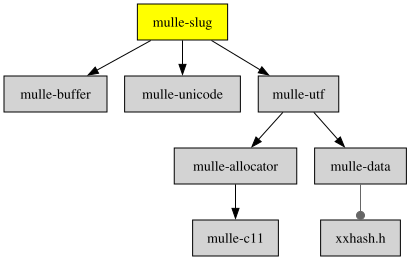

# mulle-slug

#### 🐌 Creates URL slugs

Create a [slug](https://de.ryte.com/wiki/Slug) from some arbitrary text,
suitable for inclusion in a URL as a path or fragment.

#### What is a Slug?

A slug is a URL-safe representation of a page title, often used in web
development to create clean and readable URLs.
Slugs are typically all lowercase and replace spaces with hyphens, making them
more human-friendly than raw URL-encoded strings.
For example, the page title "A Beginner's Guide to Web Development" could have
the slug "a-beginners-guide-to-web-development". The term "slug" is derived
from the publishing industry, where it refers to a short, descriptive label for
an article or story. **mulle-slug** preserves case though.


| Release Version                                       | Release Notes  | AI Documentation
|-------------------------------------------------------|----------------|---------------
|  [](//github.com/mulle-c/mulle-slug/actions)  | [RELEASENOTES](RELEASENOTES.md) | [DeepWiki for mulle-slug](https://deepwiki.com/mulle-c/mulle-slug)


## Documentation & Guides

* [API Summary](asset/dox/api/toc)

## API

### `mulle_slugify`

```c
char *mulle_slugify(char *dst, size_t dst_len, char *src, size_t src_len);
```

This function creates a URL slug from the given source string `src` and stores
it in the destination buffer `dst`. The `dst_len` parameter specifies the size
of the destination buffer, and `src_len` specifies the length of the source
string. Pass `(size_t) -1` for `src_len` to use `strlen` on a NUL-terminated
source. Returns `dst` on success, `NULL` if `dst_len` is 0.

### `mulle_slugify_with_delimiter`

```c
char *mulle_slugify_with_delimiter(char *dst, size_t dst_len, char *src, size_t src_len, char delimiter);
```

This function is similar to `mulle_slugify`, but it allows you to specify a
custom delimiter character instead of the default hyphen `-`.

### `mulle_utf8_slugify`

```c
char *mulle_utf8_slugify(char *s);
```

Returns a `mulle_free`-able slugified copy of the NUL-terminated input string.
Returns `NULL` if `s` is `NULL`.

### `mulle_buffer_add_slugified_utf8data`

```c
void mulle_buffer_add_slugified_utf8data(struct mulle_buffer *buffer, struct mulle_utf8data data);
```

Appends the slugified form of `data` to an existing `mulle_buffer`.
This is the zero-malloc building block — use it when constructing larger
strings or HTML pages.

### Example Code

Here's an example of how to use the mulle-slug library:

```c
#include <stdio.h>
#include <string.h>
#include <mulle-slug/mulle-slug.h>

int main() {
    const char *input = "Take me home!";
    char output[256];

    mulle_slugify(output, sizeof(output), input, strlen(input));

    printf("Input: %s\n", input);
    printf("Slugified: %s\n", output);

    return 0;
}
```

This example demonstrates how to use the `mulle_slugify` function to create a
URL slug from the given input string. The output will be:

```
Input: Take me home!
Slugified: Take-me-home
```


### You are here




## Add

### Add mulle-slug via mulle-core

mulle-slug is a component of the
[mulle-core](//github.com/mulle-core/mulle-core) library.
In your code include its umbrella header:

``` c
#include <mulle-core/mulle-core.h>
```

In your project add mulle-core as a git submodule and link against it:

``` bash
git submodule add -f "https://github.com/mulle-core/mulle-core.git" \
                     "stash/mulle-core"
git submodule update --init --recursive
```

then add these comands to your `CMakeLists.txt`:

``` cmake
include_directories( SYSTEM "stash/mulle-core/src")
add_subdirectory( stash/mulle-core)
target_link_libraries( ${PROJECT_NAME} PUBLIC mulle-core)
```

Or let [mulle-sde](//github.com/mulle-sde) do it:

``` sh
mulle-sde add mulle-core/mulle-core
```


### Add mulle-slug as a cmake subproject

In your code include its header:

``` c
#include <mulle-slug/mulle-slug.h>
```

Add mulle-slug and dependencies as git submodules and link against
them:

``` bash
git submodule add -f --name "mulle-c11" \
                            "https://github.com/mulle-c/mulle-c11.git" \
                            "stash/mulle-c11"
git submodule add -f --name "mulle-allocator" \
                            "https://github.com/mulle-c/mulle-allocator.git" \
                            "stash/mulle-allocator"
git submodule add -f --name "src/xxhash/xxhash.h" \
                            "https://raw.githubusercontent.com/mulle-c/xxHash/refs/heads/dev/xxhash.h" \
                            "stash/src/xxhash/xxhash.h"
git submodule add -f --name "mulle-data" \
                            "https://github.com/mulle-c/mulle-data.git" \
                            "stash/mulle-data"
git submodule add -f --name "mulle-utf" \
                            "https://github.com/mulle-c/mulle-utf.git" \
                            "stash/mulle-utf"
git submodule add -f --name "mulle-buffer" \
                            "https://github.com/mulle-c/mulle-buffer.git" \
                            "stash/mulle-buffer"
git submodule add -f --name "mulle-unicode" \
                            "https://github.com/mulle-c/mulle-unicode.git" \
                            "stash/mulle-unicode"
git submodule add -f --name "mulle-slug" \
                        "https://github.com/mulle-c/mulle-slug" \
                        "stash/mulle-slug"
git submodule update --init --recursive
```

``` cmake
include_directories( SYSTEM "${CMAKE_BINARY_DIR}/include")

add_subdirectory( stash/mulle-c11)
add_subdirectory( stash/mulle-allocator)
add_subdirectory( stash/src/xxhash/xxhash.h)
add_subdirectory( stash/mulle-data)
add_subdirectory( stash/mulle-utf)
add_subdirectory( stash/mulle-buffer)
add_subdirectory( stash/mulle-unicode)
add_subdirectory( stash/mulle-slug)

target_link_libraries( ${PROJECT_NAME} PUBLIC mulle-c11)
target_link_libraries( ${PROJECT_NAME} PUBLIC mulle-allocator)
target_link_libraries( ${PROJECT_NAME} PUBLIC src/xxhash/xxhash.h)
target_link_libraries( ${PROJECT_NAME} PUBLIC mulle-data)
target_link_libraries( ${PROJECT_NAME} PUBLIC mulle-utf)
target_link_libraries( ${PROJECT_NAME} PUBLIC mulle-buffer)
target_link_libraries( ${PROJECT_NAME} PUBLIC mulle-unicode)
target_link_libraries( ${PROJECT_NAME} PUBLIC mulle-slug)
```

Or let [mulle-sde](//github.com/mulle-sde) do it:

``` sh
mulle-sde add github:mulle-c/mulle-slug
```

## Individual Install

Install all the prerequisites.

``` bash
PREFIX=/tmp/usr/local
BUILD_DIR="mulle-slug/build"

cmake -S "mulle-slug" -B "${BUILD_DIR}"    \
  -DCMAKE_BUILD_TYPE="Release"                  \
  -DCMAKE_INSTALL_PREFIX="${PREFIX}"            \
  -DCMAKE_PREFIX_PATH="${PREFIX}"               \
  -DCMAKE_C_FLAGS="-I"${PREFIX}"/include"       \
&& cmake --build "${BUILD_DIR}"  --parallel     \
&& cmake --install "${BUILD_DIR}"
```

## Acknowledgments

This is a C port of [C++ Slugify](https://github.com/thomasbrueggemann/cpp-slugify)
with a different, probably much faster, algorithm.

## Author

[Nat!](https://mulle-kybernetik.com/weblog) for Mulle kybernetiK  


